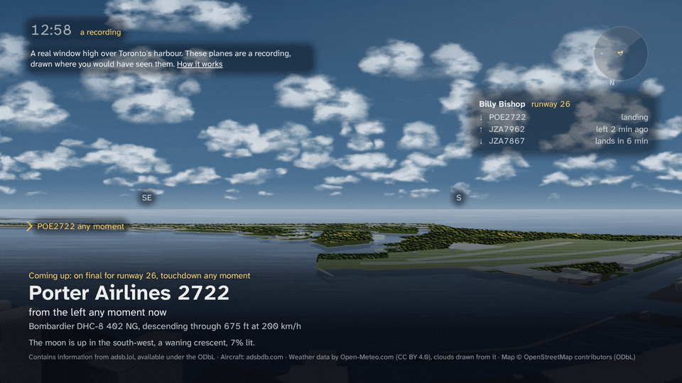
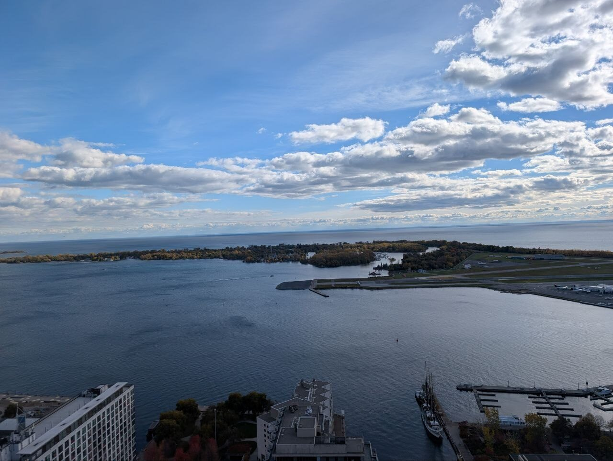
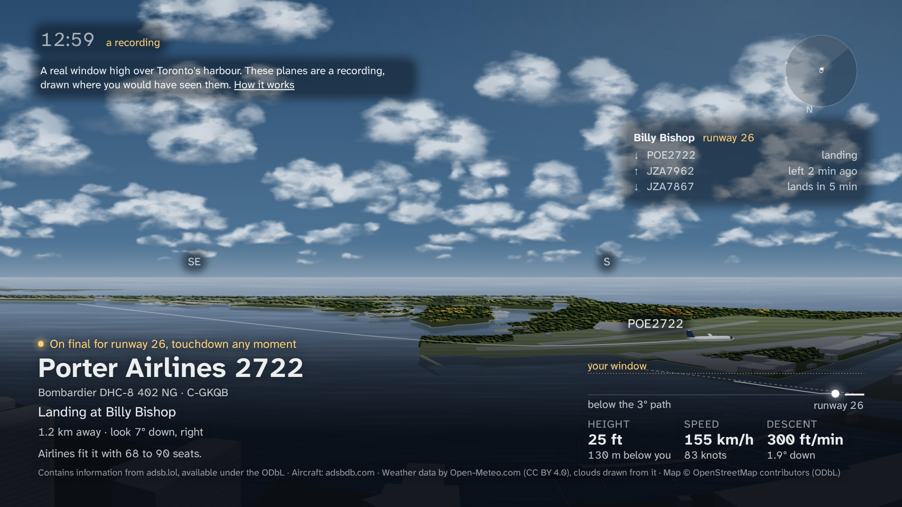
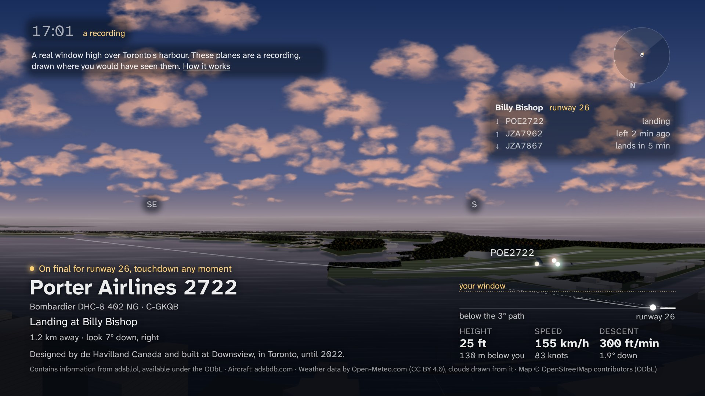
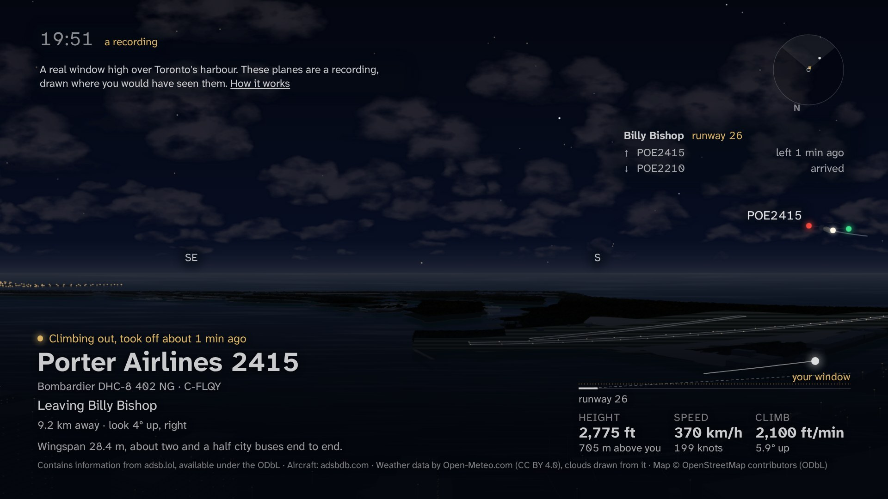
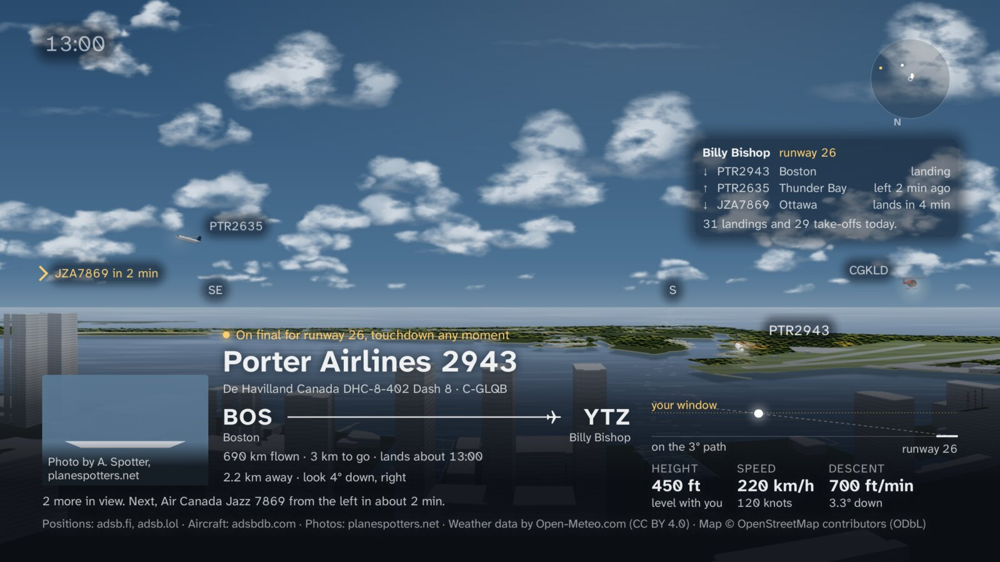
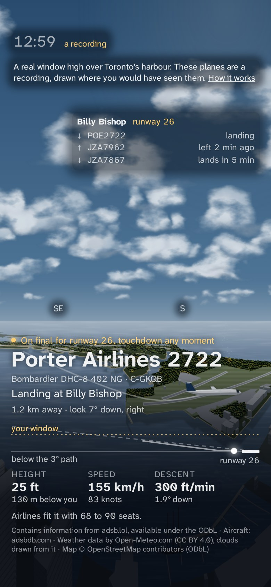
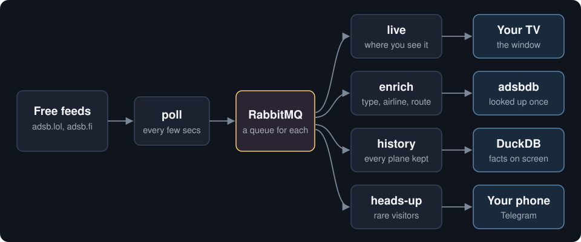

# overhead

The planes you can see from your window, on a spare screen or TV. It reads free flight-tracking feeds, so you need no radio, and draws each plane where you would see it through the glass.

**[See it live](https://overhead-window.netlify.app)**, from a real window over Toronto's harbour. When that machine is off, the page plays a recording and says so.



<sub>A real landing at Billy Bishop, in that moment's real light and cloud, at 5× speed.</sub>

## It matches the view

| Outside | On the screen |
|---|---|
|  |  |

The sun, moon and stars are worked out for the moment you look. The clouds come from the weather.

| Dusk | Night |
|---|---|
|  |  |

| At home, with routes and photos (test data) | On a phone |
|---|---|
|  |  |

## Try it

You need Docker. The first run takes a few minutes to build.

```sh
git clone https://github.com/amirradjou/overhead
cd overhead
docker compose up -d
```

Open <http://localhost:8090>. With no settings you get the whole sky around Toronto Pearson.

**Make it your window.** Put this in a `.env` file, then run `docker compose up -d` again:

```sh
OVERHEAD_LAT=43.65          # where you live
OVERHEAD_LON=-79.38
OVERHEAD_WINDOW_AZ=200      # the way the window faces, in degrees
OVERHEAD_WINDOW_FOV=100     # how wide it looks
OVERHEAD_WINDOW_MIN_EL=8    # the lowest angle you can see over the roofs
```

You can measure these with a phone: [docs/setup.md](docs/setup.md#1-home-and-window) shows how.

**Just want the planes in a terminal?** With Go 1.26:

```sh
make build && ./bin/overhead watch
```

## How it works

Airliners broadcast their position, and hobbyists share what they receive through free networks. overhead asks those networks what is flying nearby and works out where each plane sits in your window.



Built with Go, RabbitMQ, Next.js and DuckDB. The poller and pipeline are proven on real runs. A path through S3 and Snowpipe into Snowflake, set up with Terraform, is built but has not run on a real account yet ([milestones](docs/SPEC.md#milestones)).

## More

- [Guide](docs/GUIDE.md): every command, the TV browser check, the code layout
- [Setup](docs/setup.md): measuring the window, the TV, Telegram alerts, the cloud accounts
- [Spec](docs/SPEC.md): what each part does, the data sources and their terms, milestones and results

Code: [MIT](LICENSE). The map, the flight recording, the font and the window photo have their own terms: [NOTICE.md](NOTICE.md).
